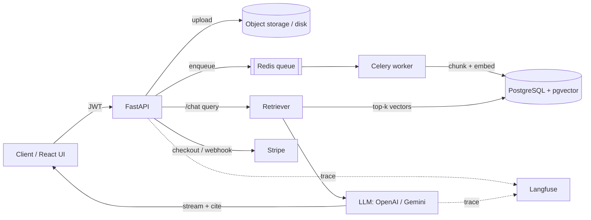

# DocuMind AI — Production Document-Q&A SaaS (RAG)

> Upload your documents, ask questions in natural language, get cited answers.
> A multi-tenant RAG SaaS built with **FastAPI + PostgreSQL/pgvector + LangChain**,
> with JWT auth, Stripe billing, async ingestion, per-user rate limiting, and
> LLM observability.

<p align="left">
  
  
  
  
  
</p>

---

## ✨ Features

- **Retrieval-Augmented Generation** — semantic search over your documents with `pgvector`, answers grounded in retrieved chunks with inline **citations**.
- **Multi-tenant & secure** — JWT auth; every document, chunk, and query is scoped to the owning user.
- **Async ingestion** — uploads return instantly; chunking + embedding run in **Celery/Redis** background workers.
- **Streaming answers** — token-by-token responses over Server-Sent Events.
- **Stripe billing** — free vs. pro subscription tiers, webhook-driven activation.
- **Per-user rate limiting** — Redis fixed-window limiter keyed by tenant + plan.
- **Observability** — every LLM call traced in **Langfuse** (token cost, latency, retrieval quality).
- **Tested & CI'd** — `pytest` suite + GitHub Actions pipeline, fully Dockerized.

---

## 🏗️ Architecture



**Request flow (query):** `auth → rate-limit → embed question → pgvector top-k → build grounded prompt → stream LLM answer with citations → trace to Langfuse`.

---

## 🧱 Tech Stack

| Layer | Choice |
|---|---|
| API | FastAPI (async), Pydantic v2 |
| DB | PostgreSQL 16 + `pgvector`, SQLAlchemy 2.0 async, Alembic |
| Vector search | pgvector (cosine, IVFFlat/HNSW) |
| Embeddings | OpenAI `text-embedding-3-small` (swappable → `bge-base`) |
| LLM | OpenAI / Google Gemini via LangChain |
| Queue | Celery + Redis |
| Auth | JWT (python-jose) + bcrypt (passlib) |
| Billing | Stripe Checkout + webhooks |
| Observability | Langfuse |
| Infra | Docker Compose, GitHub Actions CI |

---

## 🚀 Quick start

```bash
git clone https://github.com/jaiminpanchal2002/documind-ai.git
cd documind-ai
cp .env.example .env          # fill in OPENAI_API_KEY, STRIPE keys, etc.
docker compose up --build
```

- API docs: http://localhost:8000/docs
- Health: http://localhost:8000/health

Run locally without Docker:

```bash
python -m venv .venv && source .venv/bin/activate   # Windows: .venv\Scripts\activate
pip install -r requirements.txt
uvicorn app.main:app --reload
# in a second terminal:
celery -A app.workers.celery_app.celery worker --loglevel=info
```

---

## 📡 Core API

| Method | Path | Description |
|---|---|---|
| `POST` | `/auth/signup` | Create account, returns JWT |
| `POST` | `/auth/login` | Login, returns JWT |
| `POST` | `/documents` | Upload a document (async ingest) |
| `GET`  | `/documents` | List your documents + ingest status |
| `POST` | `/chat` | Ask a question → streamed, cited answer |
| `POST` | `/billing/checkout` | Start a Stripe checkout session |
| `POST` | `/billing/webhook` | Stripe webhook (subscription events) |

---

## 🖥️ Frontend

A minimal React (Vite) UI lives in `frontend/` — signup/login, document upload with
live ingest status, and a chat view that renders answers with source citations.

```bash
cd frontend
cp .env.example .env          # VITE_API_URL=http://localhost:8000
npm install
npm run dev                   # http://localhost:5173
```

## 🧪 Tests

```bash
pytest -q                     # unit tests (no services needed)

# full auth -> upload -> chat flow against real Postgres (embeddings/LLM mocked):
docker compose up -d db redis
pytest -q -m integration
```

---

## 🗺️ Roadmap

- [ ] Hybrid retrieval (pgvector + full-text, RRF fusion)
- [ ] Cross-encoder reranking
- [ ] RAGAS evaluation gate in CI
- [ ] Multi-file collections & sharing
- [ ] Usage analytics dashboard (React)

---

## 📸 Screenshots

> _Add screenshots of the upload flow, a cited answer, and the Langfuse trace here._

---

## 📄 License

MIT © Jaimin Panchal
